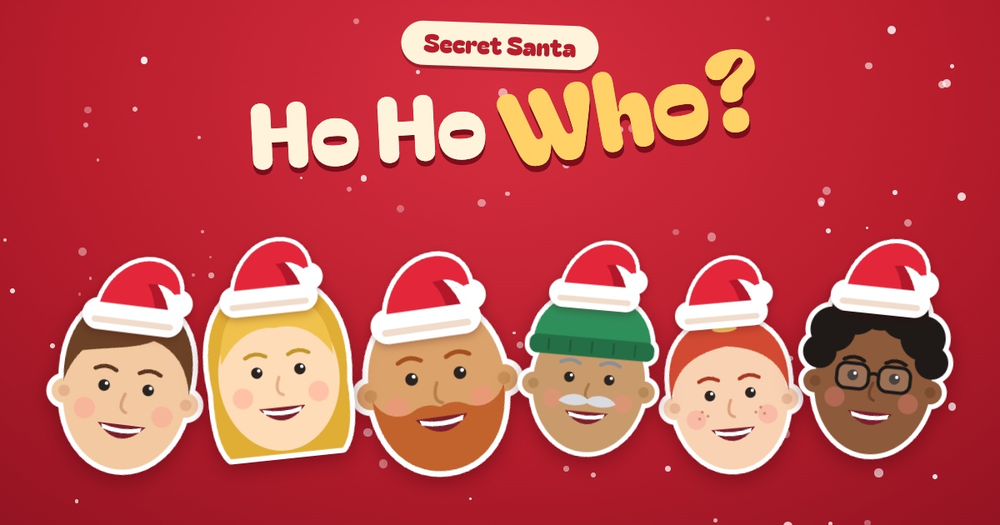

# Secret Santa, but it's your friends' floating heads



A tiny website for drawing Secret Santa names. Everyone in the group opens the same link, taps their
own floating head, opens the present, and finds out who they're buying for.

- No accounts, no app, no spreadsheet.
- Nobody gets themselves, and everybody gets exactly one person.
- The organiser doesn't see who has whom, so they can play too.
- The heads float, spin, and can be flung around the screen.

This repository is a template with six cartoon placeholders. Swap in photos of your own friends,
give it your own name, and send the link to the group chat.

**You don't need to know how to code.** An AI coding agent (Claude Code, Cursor, Codex and similar)
can do all of it, and this folder includes a guide written for the agent: [AGENTS.md](AGENTS.md).
Your part is collecting photos and pasting one message.

## Make your own

**1. Get your own copy.** Click the green **Code** button on GitHub, then **Download ZIP**, and
unzip it. (If you use GitHub yourself: **Use this template**, and make your copy **private**, because
it will hold your friends' faces.)

**2. Collect one photo per person** and put them in the `photos` folder. Name each file after the
person: `Alex.jpg`, `Mary Kate.png`. That name is what the site shows.

- The face should be clear, roughly facing the camera, and not tiny.
- Hats and glasses are fine. Group photos are fine if your person has the biggest face in the shot;
  otherwise crop it first.
- Phone photos work as they are.

**3. Open the folder in your coding agent** and paste this, with the blanks filled in:

```text
Read AGENTS.md, then set this Secret Santa site up for my group.

- Name of the site: ________  (the word "________" is the punchline: highlight it)
- Small label above the name: Secret Santa
- Line to show after the reveal, like a budget or date: ________  (or nothing)
- What to call us on the "Back to the ..." button: ________
- The photos are in the photos folder, one per person, named after them.
- I'm in the draw too, so never show me or tell me who anyone gets.

Cut out the heads and show me the cut-outs before going any further. When I'm happy, make the
preview picture, test everything in test mode, then put it online for free and give me the link.
```

**4. Send the link to the group.** Something like: *"Secret Santa time. Tap your own head, open the
present, tell no one. Reply 🎅 when you've done it."*

The head cutter needs a Mac (it uses Apple's built-in face detection, so there's nothing to install
beyond Apple's free command line tools). On Windows or Linux your agent will need to cut the heads
out another way; AGENTS.md tells it what the site needs.

## More things to paste

Fix a cut-out:

```text
Sam's cut-out has part of someone's shoulder on the left side. Fix it and show me the sheet again.
```

Rename it or change the wording:

```text
Rename the site to "________" with "________" as the highlighted word, and change the button after
the reveal to say "Back to the ________". Update the link preview and the preview picture to match.
```

Change the present:

```text
Make the present take three taps, with "Who wrapped this?!" as the middle line.
```

Change the look:

```text
Make it blue and silver instead of red and gold, on the site and in the preview picture.
```

Change the link:

```text
I'd like the link to have "________" in it. Set that up and update the link preview to match.
```

Try it yourself without spoiling anything:

```text
Start the site on my computer in test mode so I can play with it. Don't show me any real matches.
```

Check the real thing:

```text
Check that the live site works from start to finish, without showing me a real match. Confirm the
original photos can't be reached online.
```

Someone joins or drops out:

```text
________ dropped out. I have / haven't shared the link yet. Tell me what changes for everyone else
before you do anything.
```

## Questions

**How does it work with no database?** The matches aren't stored anywhere. Each phone works them out
from two things: the list of people, and a secret phrase (the "seed") baked into the site. The site
shuffles everyone into one big circle using that phrase, and each person buys for the next person
round the circle. Same list and same phrase give the same circle on every phone, so no two people
can end up with the same person, and nobody can get themselves.

**Can people peek at someone else's?** It runs on the honour system. Once you've tapped your head,
your phone remembers it, and tapping anyone else's head gets you told off. Someone determined could
get around that on another device. For a group of friends that's usually the right amount of
security.

**Can I change things after I've shared the link?** Wording, colours and cut-outs: yes, any time.
The list of people or the seed: only if you're happy for *everyone* to be re-drawn, since the
matches are worked out from those.

**Can I see who has done it?** No, the site keeps no records. Ask everyone to reply 🎅 in the chat.

**Is it private?** The original photos never leave your computer; only the cut-out heads go online.
The site asks search engines not to list it. Anyone who has the link can open it, so share it only
with the group. If you keep your copy on GitHub, keep it private.

**What does it cost?** Nothing. It's a handful of small files, well inside the free plan of any
static web host.

**Does it have to be Christmas?** No. Every word on the site is in one file, and the colours are in
one place, so it can be a birthday swap or a white elephant. Ask your agent.

## What's in the folder

| | |
| --- | --- |
| `index.html` | The site |
| `config.js` | The name, every word on the site, and the seed |
| `heads/` | The cut-out heads and the list of people (made from your photos) |
| `photos/` | Your original photos. They stay on your computer |
| `share.jpg` | The picture that shows up when the link is pasted in a chat |
| `tools/` | The head cutter and the preview-picture maker |
| `AGENTS.md` | Step-by-step instructions for an AI agent |

## Doing it by hand

On a Mac, from this folder:

```bash
sh tools/cut-heads.sh          # photos/ → heads/, then look at photos/_cutouts.png
sh tools/make-share-image.sh   # makes share.jpg
python3 -m http.server 4173    # then open http://localhost:4173/?test
```

Then edit `config.js`, fill in the link-preview lines at the top of `index.html`, and upload the
site to any static host. AGENTS.md has the details, including how to fix a bad cut-out.

Add `?test` to the end of the address at any time to play with random pretend matches. Nothing is
saved in test mode, and the yellow pill in the corner lists anything you still need to fill in.

Copy it, change it, make it yours.
